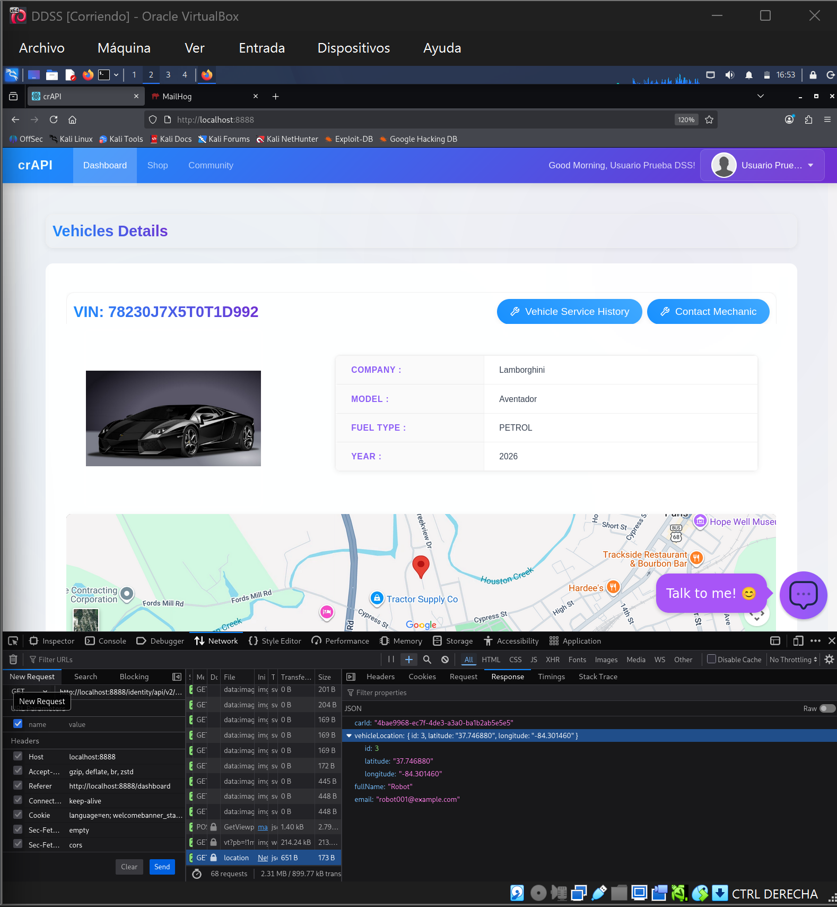
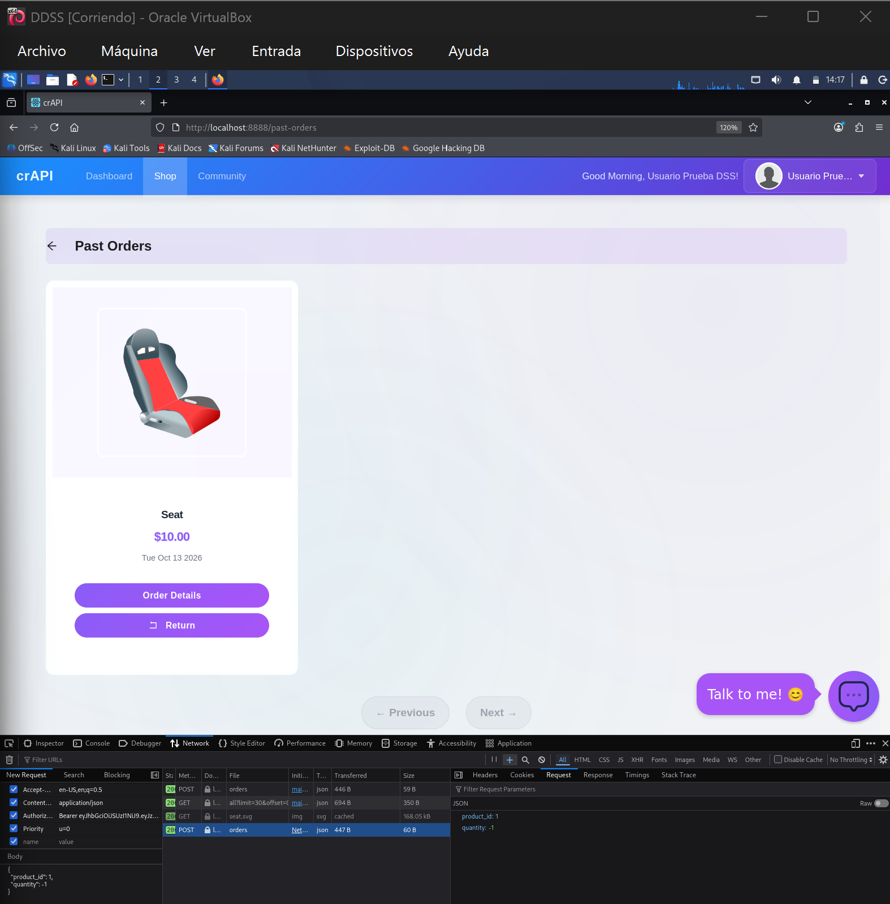
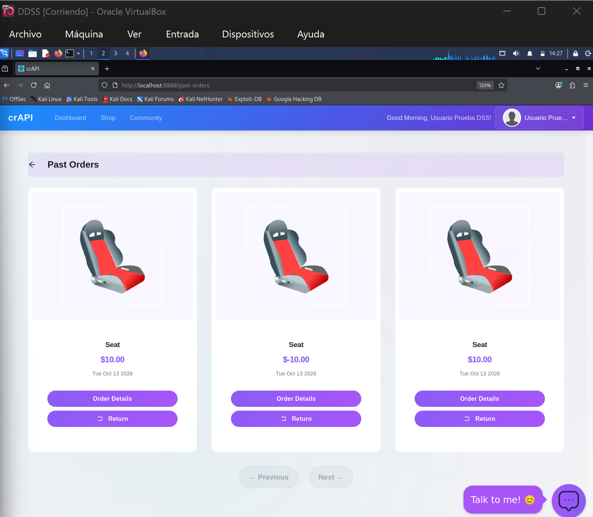
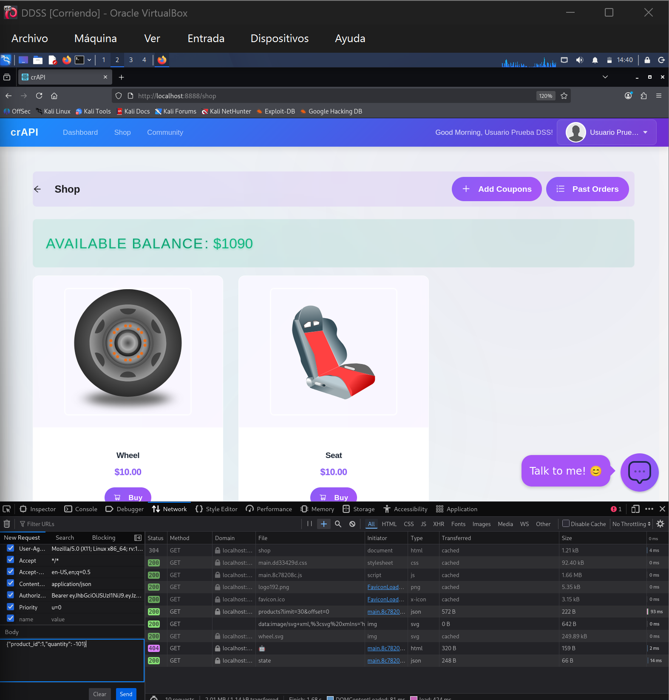
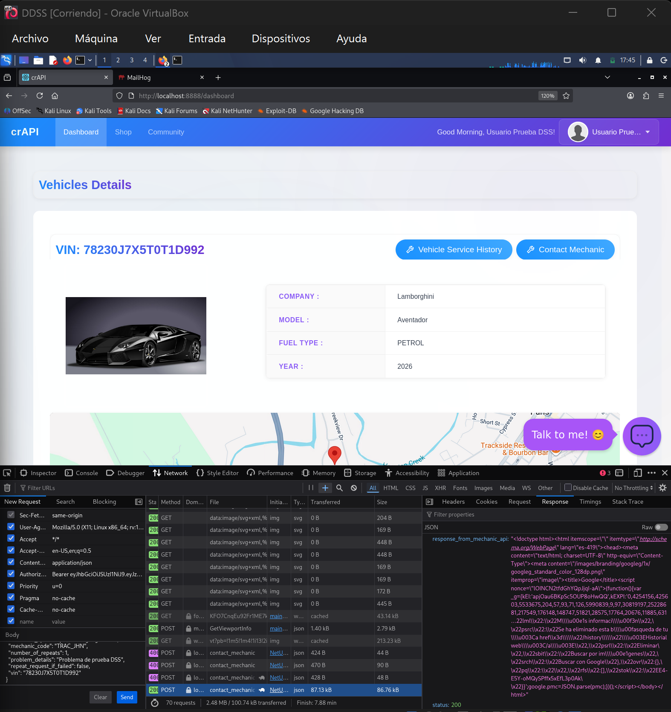
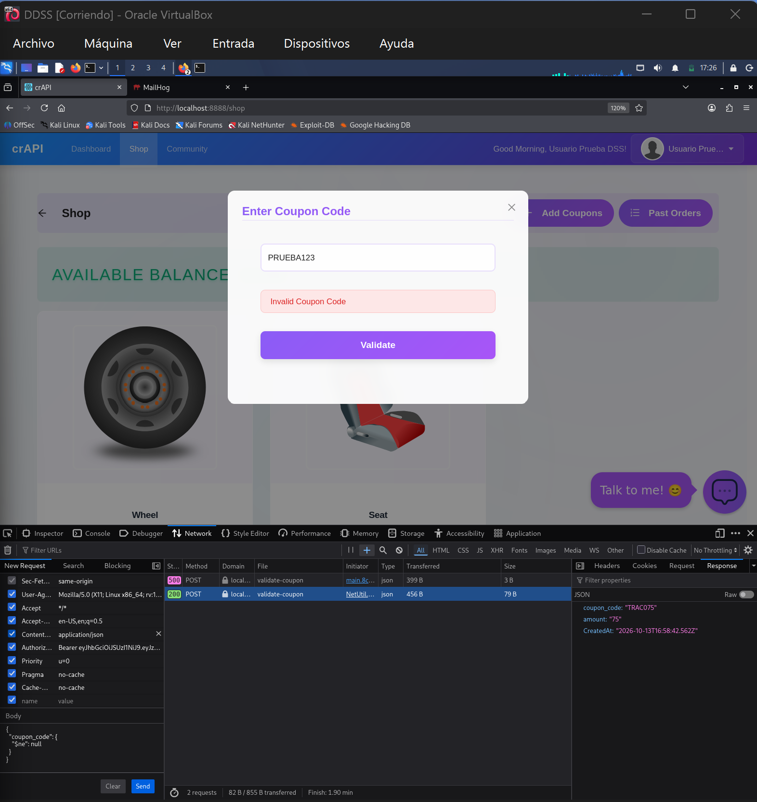

# Práctico 3 — Desarrollo Seguro de Software

Pruebas realizadas sobre OWASP Juice Shop y OWASP crAPI en un laboratorio local de Kali Linux.

## OWASP Juice Shop

### J1 — Zero Stars

**Vulnerabilidad:** validación insuficiente del valor de la calificación. El formulario limita los valores disponibles, pero el servidor aceptó una calificación de cero.

**Clasificación:** OWASP Top 10 2021 — A04: Insecure Design (validación de reglas de negocio insuficiente).

**Prueba de concepto:**
1. Abrí `Customer Feedback` y envié un comentario con una estrella.
2. En las herramientas de Firefox (`Network`), identifiqué `POST /api/Feedbacks/`.
3. Utilicé `Edit and Resend` y cambié `rating: 1` por `rating: 0`, conservando los otros campos.
4. El servidor respondió **HTTP 201 Created**, aceptando la valoración de cero estrellas.

**Evidencia:**

**Mitigación:** validar también del lado del servidor que `rating` sea un entero dentro del rango permitido (1–5) y rechazar los demás valores con un error 400.

### J2 — Login Admin

**Vulnerabilidad:** SQL Injection en el inicio de sesión: el correo introducido modifica la consulta SQL y permite omitir la comprobación de contraseña.

**Clasificación:** OWASP Top 10 2021 — A03: Injection.

**Prueba de concepto:**
1. Abrí el formulario `Login`.
2. Ingresé `admin@juice-sh.op'--` como correo y `prueba123` como contraseña.
3. El inicio de sesión devolvió **HTTP 200** y Juice Shop confirmó el desafío *Login Admin*.

**Evidencias:** solicitud de inicio de sesión con la inyección y respuesta HTTP 200; confirmación visual de Juice Shop de que se resolvió *Login Admin*.

**Mitigación:** utilizar consultas SQL parametrizadas y validar los datos de entrada; nunca concatenar valores del usuario directamente en una consulta de autenticación.

### J4 — Admin Registration

**Vulnerabilidad:** asignación indebida de privilegios mediante manipulación del registro de usuarios (Mass Assignment).

**Clasificación:** OWASP Top 10 2021 — A01: Broken Access Control.

**Prueba de concepto:**
1. Registré una cuenta normal y localicé la solicitud `POST /api/Users/` en Firefox Network.
2. Con `Edit and Resend`, usé otro correo y añadí `"role":"admin"` al JSON.
3. El servidor respondió **HTTP 201 Created** y Juice Shop confirmó *Admin Registration*.

**Evidencia:**

**Mitigación:** asignar roles exclusivamente del lado del servidor, usando una lista permitida de campos de registro y controles de autorización.

### J6 — View Basket

**Vulnerabilidad:** acceso directo a objetos sin verificar autorización (IDOR), permitiendo consultar el carrito de otra cuenta.

**Clasificación:** OWASP Top 10 2021 — A01: Broken Access Control.

**Prueba de concepto:**
1. Con una cuenta normal, abrí `Your Basket` y localicé `GET /rest/basket/6` en Firefox Network.
2. Mediante `Edit and Resend`, cambié el identificador a `GET /rest/basket/1` sin modificar la sesión.
3. El servidor respondió **HTTP 200 OK** y Juice Shop confirmó el desafío *View Basket*.

**Evidencia:**

**Mitigación:** validar en el servidor que el usuario autenticado sea propietario del carrito solicitado, rechazando el acceso a carritos ajenos.

### J7 — Christmas Special

**Vulnerabilidad:** la búsqueda permite una SQL Injection que revela productos retirados, y el servidor no comprueba que el producto siga disponible al agregarlo al carrito y comprarlo.

**Clasificación:** OWASP Top 10 2021 — A03: Injection (búsqueda) y A04: Insecure Design (validación de disponibilidad del producto).

**Prueba de concepto:**
1. Consulté `/rest/products/search?q='))--` y encontré *Christmas Super-Surprise-Box (2014 Edition)*, producto eliminado con `id: 10` y `deletedAt` informado.
2. Capturé `POST /api/BasketItems/` en Firefox Network y reenvié la solicitud con `ProductId: 10`, conservando el carrito de mi cuenta.
3. El producto apareció en el carrito y completé el checkout; Juice Shop confirmó el desafío *Christmas Special*.

**Evidencias:**

**Mitigación:** parametrizar las consultas SQL y verificar en el servidor que el producto esté activo tanto al añadirlo al carrito como al confirmar el pedido.

## OWASP crAPI

### C1 — Find Another User's Vehicle Location

**Vulnerabilidad:** BOLA: falta de autorización por objeto para consultar la ubicación de vehículos ajenos.

**Clasificación:** OWASP API Security Top 10 2023 — API1: Broken Object Level Authorization.

**Prueba de concepto:**
1. Con mi cuenta, identifiqué la solicitud `GET /identity/api/v2/vehicle/{id}/location` de mi vehículo.
2. En `Community`, encontré el identificador `author.vehicleId` de un vehículo de otro usuario.
3. Mediante `Edit and Resend`, sustituí el ID de la URL y conservé la autorización de mi sesión. La API respondió **HTTP 200** y devolvió las coordenadas y datos del otro propietario.

**Evidencia:**

**Mitigación:** comprobar en cada petición que el vehículo consultado pertenezca al usuario autenticado o que éste tenga autorización expresa.

### C3 — Get an Item for Free

**Vulnerabilidad:** validación insuficiente de la cantidad comprada. La API acepta valores negativos que invierten el importe de la operación.

**Clasificación:** OWASP API Security Top 10 2023 — API6: Unrestricted Access to Sensitive Business Flows (abuso de la lógica de compra).

**Prueba de concepto:**
1. Compré un Seat de $10 y capturé `POST /workshop/api/shop/orders` en Firefox Network.
2. Reenvié la solicitud con `{"product_id":1,"quantity":-1}`; el servidor respondió **HTTP 200**.
3. En `Past Orders` se registró un Seat con importe **−$10**; el saldo recuperó los $10 de la compra inicial.

**Evidencias:**

**Mitigación:** validar en el servidor que `quantity` sea un entero positivo y calcular importes exclusivamente con valores permitidos.

### C4 — Increase Balance by $1,000 or More

**Vulnerabilidad:** el mismo defecto de validación permite acreditar importes arbitrarios manipulando la cantidad.

**Clasificación:** OWASP API Security Top 10 2023 — API6: Unrestricted Access to Sensitive Business Flows.

**Prueba de concepto:**
1. Capturé una compra normal de Seat (`product_id: 1`, precio $10).
2. Reenvié `POST /workshop/api/shop/orders` con `{"product_id":1,"quantity":-101}`.
3. El saldo aumentó de **$80 a $1.090**, es decir, **$1.010**.

**Evidencia:**

**Mitigación:** rechazar cantidades no positivas y comprobar en el servidor los importes y movimientos de saldo antes de procesar cualquier compra.

### C5 — Server-Side Request Forgery (SSRF)

**Vulnerabilidad:** la función `Contact Mechanic` permite indicar desde el cliente la URL de destino de una solicitud realizada por el servidor.

**Clasificación:** OWASP API Security Top 10 2023 — API7: Server Side Request Forgery.

**Prueba de concepto:**
1. En `Dashboard → Contact Mechanic`, envié un reporte de prueba y localicé la solicitud `POST contact_mechanic` en Firefox Network.
2. Con `Edit and Resend`, modifiqué únicamente `mechanic_api` para que apuntara a `https://www.google.com`, conservando los demás parámetros y la sesión.
3. La respuesta devolvió `status: 200` y el campo `response_from_mechanic_api` contenía HTML de Google, comenzando por `<!doctype html>`. Esto evidencia que el backend consultó un destino elegido por el cliente.

**Evidencia:**

**Mitigación:** limitar los destinos a servicios de mecánicos autorizados mediante una lista permitida; validar esquema, host, resolución DNS y redirecciones, y bloquear acceso a redes internas y servicios de metadatos.

### C6 — NoSQL Injection: Find Coupons Without Knowing the Code

**Vulnerabilidad:** inyección NoSQL en la validación de cupones. La API acepta un objeto con un operador de consulta en el campo `coupon_code` en lugar de exigir un código de texto.

**Clasificación:** OWASP API Security Top 10 2023 — API8: Security Misconfiguration (validación insuficiente de entradas que permite una consulta NoSQL no prevista). También corresponde a la clase general de vulnerabilidades de inyección.

**Prueba de concepto:**
1. Desde `Shop → Add Coupons`, envié el código inválido `PRUEBA123` e identifiqué la solicitud `POST /community/api/v2/coupon/validate-coupon` en Firefox Network.
2. Con `Edit and Resend`, sustituí el cuerpo por `{"coupon_code":{"$ne":null}}`, manteniendo la autenticación de mi sesión.
3. El servidor respondió **HTTP 200** y devolvió un cupón previamente desconocido: `TRAC075`, con `amount: "75"`.
4. Ingresé `TRAC075` en el formulario normal y la aplicación confirmó **«Success — Coupon applied»**.

**Evidencia:**

**Mitigación:** verificar del lado del servidor que `coupon_code` sea una cadena de texto con el formato permitido; rechazar objetos y operadores de consulta, y construir las consultas con filtros controlados por el servidor.

## Entrega

Entregar este documento y las capturas de la carpeta `evidencias/`, manteniendo las rutas relativas para visualizar las pruebas.
