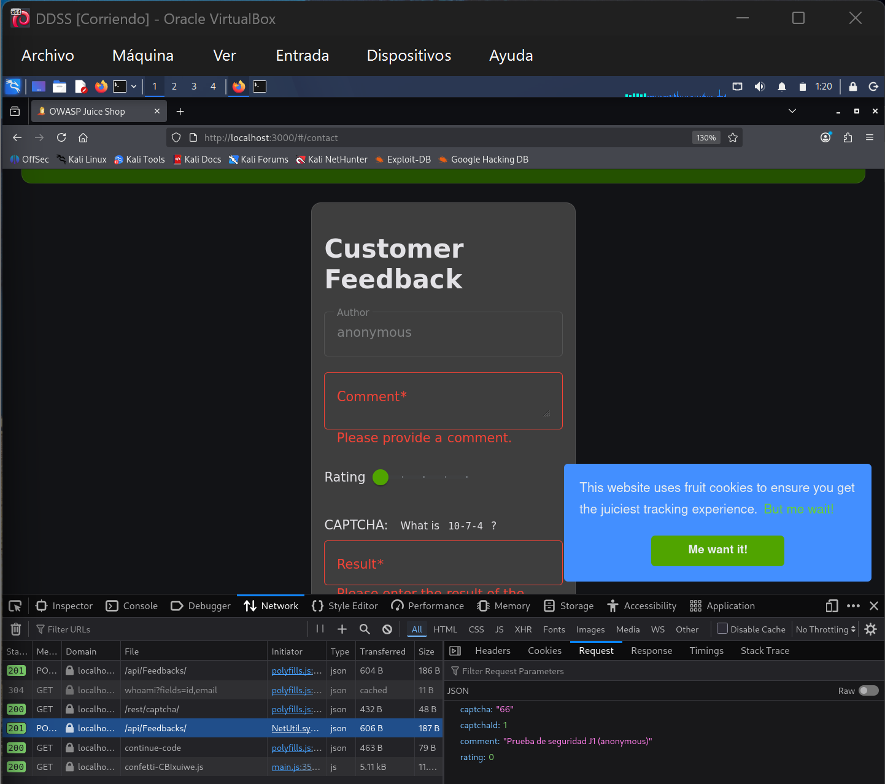
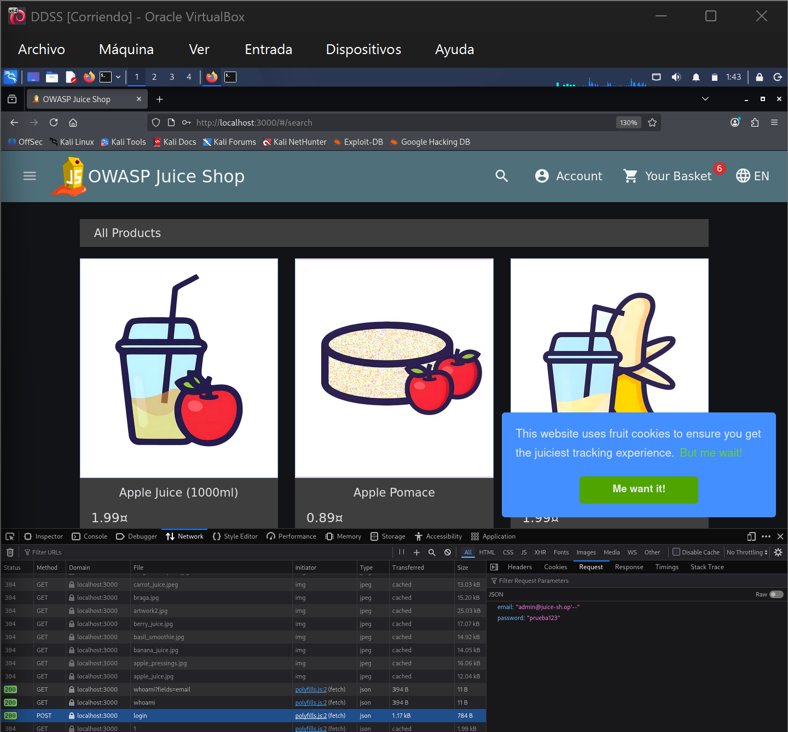
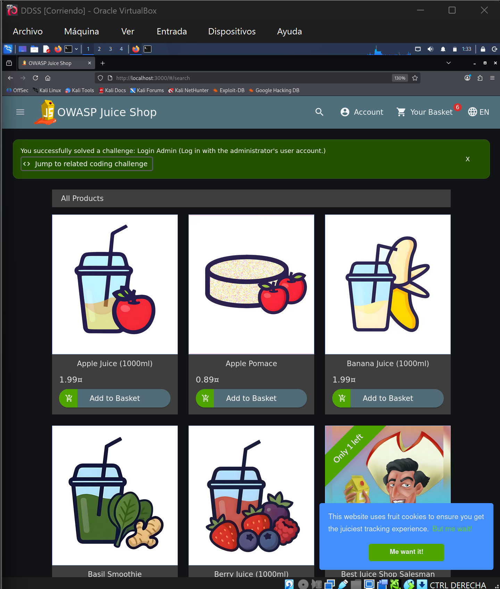
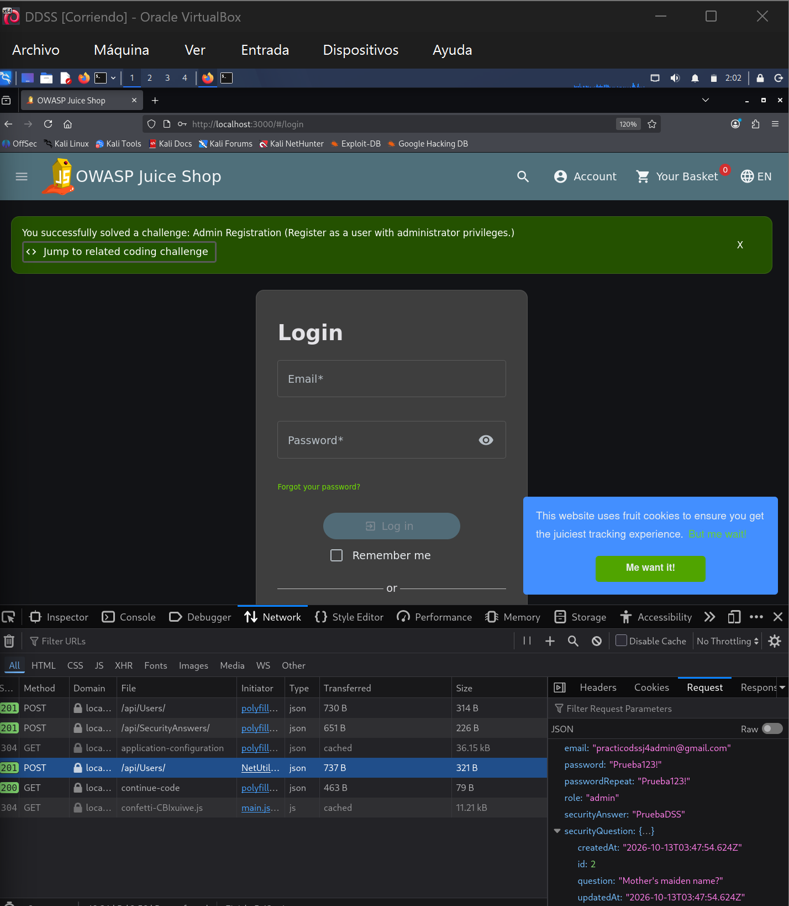
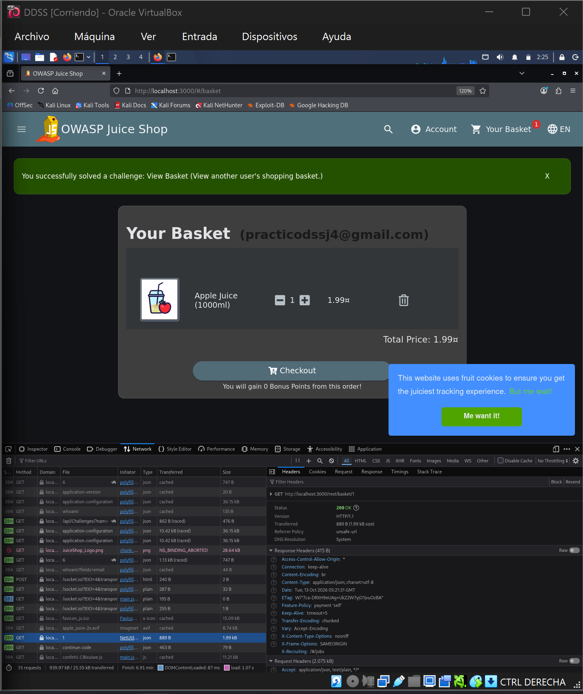
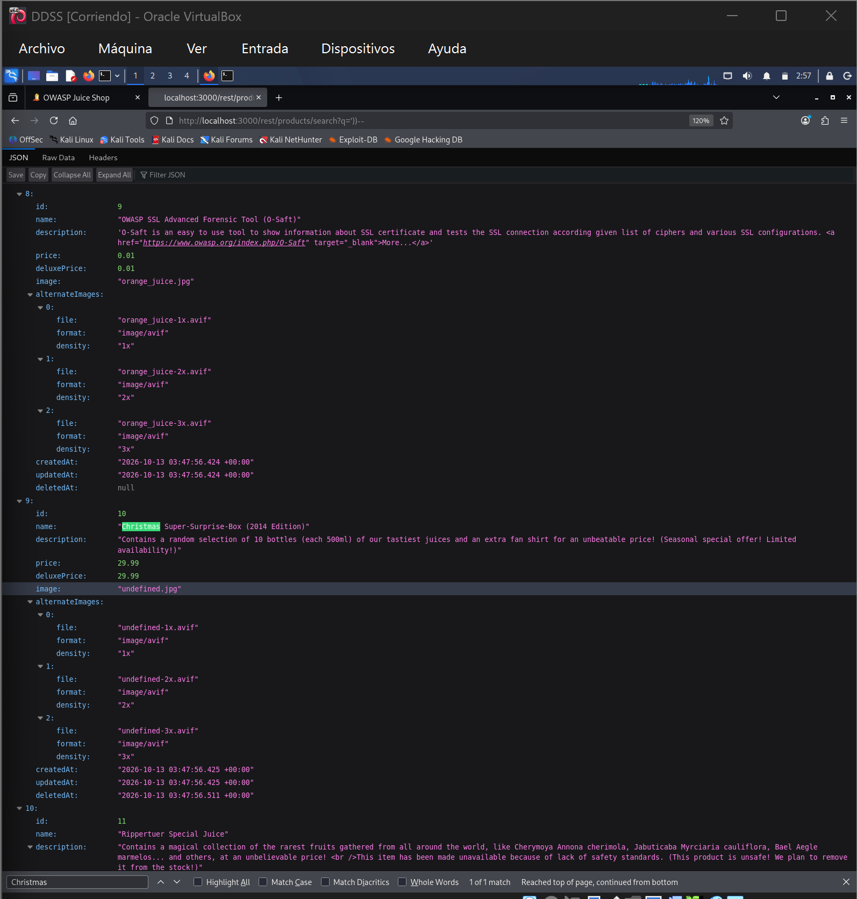
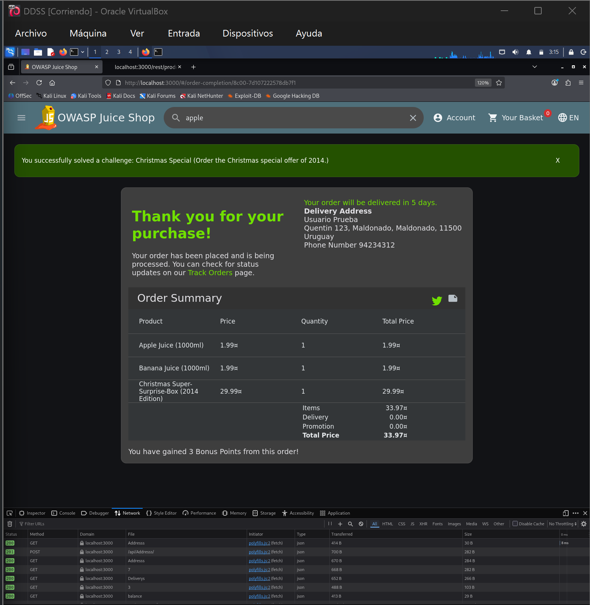

# Práctico 3 — Desarrollo Seguro de Software

Pruebas realizadas sobre OWASP Juice Shop y OWASP crAPI en un laboratorio local de Kali Linux.

## Avance

| Aplicación | Resueltos | Requeridos |
| --- | ---: | ---: |
| Juice Shop | 5 | 5 |
| crAPI | 0 | 5 |

## OWASP Juice Shop

### J1 — Zero Stars

**Vulnerabilidad:** validación insuficiente del valor de la calificación. El formulario limita los valores disponibles, pero el servidor aceptó una calificación de cero.

**Clasificación:** OWASP Top 10 2021 — A04: Insecure Design (validación de reglas de negocio insuficiente).

**Prueba de concepto:**
1. Abrí `Customer Feedback` y envié un comentario con una estrella.
2. En las herramientas de Firefox (`Network`), identifiqué `POST /api/Feedbacks/`.
3. Utilicé `Edit and Resend` y cambié `rating: 1` por `rating: 0`, conservando los otros campos.
4. El servidor respondió **HTTP 201 Created**, aceptando la valoración de cero estrellas.

**Evidencia:**

**Mitigación:** validar también del lado del servidor que `rating` sea un entero dentro del rango permitido (1–5) y rechazar los demás valores con un error 400.

### J2 — Login Admin

**Vulnerabilidad:** SQL Injection en el inicio de sesión: el correo introducido modifica la consulta SQL y permite omitir la comprobación de contraseña.

**Clasificación:** OWASP Top 10 2021 — A03: Injection.

**Prueba de concepto:**
1. Abrí el formulario `Login`.
2. Ingresé `admin@juice-sh.op'--` como correo y `prueba123` como contraseña.
3. El inicio de sesión devolvió **HTTP 200** y Juice Shop confirmó el desafío *Login Admin*.

**Evidencias:** solicitud de inicio de sesión con la inyección y respuesta HTTP 200; confirmación visual de Juice Shop de que se resolvió *Login Admin*.

**Mitigación:** utilizar consultas SQL parametrizadas y validar los datos de entrada; nunca concatenar valores del usuario directamente en una consulta de autenticación.

### J4 — Admin Registration

**Vulnerabilidad:** asignación indebida de privilegios mediante manipulación del registro de usuarios (Mass Assignment).

**Clasificación:** OWASP Top 10 2021 — A01: Broken Access Control.

**Prueba de concepto:**
1. Registré una cuenta normal y localicé la solicitud `POST /api/Users/` en Firefox Network.
2. Con `Edit and Resend`, usé otro correo y añadí `"role":"admin"` al JSON.
3. El servidor respondió **HTTP 201 Created** y Juice Shop confirmó *Admin Registration*.

**Evidencia:**

**Mitigación:** asignar roles exclusivamente del lado del servidor, usando una lista permitida de campos de registro y controles de autorización.

### J6 — View Basket

**Vulnerabilidad:** acceso directo a objetos sin verificar autorización (IDOR), permitiendo consultar el carrito de otra cuenta.

**Clasificación:** OWASP Top 10 2021 — A01: Broken Access Control.

**Prueba de concepto:**
1. Con una cuenta normal, abrí `Your Basket` y localicé `GET /rest/basket/6` en Firefox Network.
2. Mediante `Edit and Resend`, cambié el identificador a `GET /rest/basket/1` sin modificar la sesión.
3. El servidor respondió **HTTP 200 OK** y Juice Shop confirmó el desafío *View Basket*.

**Evidencia:**

**Mitigación:** validar en el servidor que el usuario autenticado sea propietario del carrito solicitado, rechazando el acceso a carritos ajenos.

### J7 — Christmas Special

**Vulnerabilidad:** la búsqueda permite una SQL Injection que revela productos retirados, y el servidor no comprueba que el producto siga disponible al agregarlo al carrito y comprarlo.

**Clasificación:** OWASP Top 10 2021 — A03: Injection (búsqueda) y A04: Insecure Design (validación de disponibilidad del producto).

**Prueba de concepto:**
1. Consulté `/rest/products/search?q='))--` y encontré *Christmas Super-Surprise-Box (2014 Edition)*, producto eliminado con `id: 10` y `deletedAt` informado.
2. Capturé `POST /api/BasketItems/` en Firefox Network y reenvié la solicitud con `ProductId: 10`, conservando el carrito de mi cuenta.
3. El producto apareció en el carrito y completé el checkout; Juice Shop confirmó el desafío *Christmas Special*.

**Evidencias:**

**Mitigación:** parametrizar las consultas SQL y verificar en el servidor que el producto esté activo tanto al añadirlo al carrito como al confirmar el pedido.

## OWASP crAPI

_Pendiente._

## Entrega

Un único ZIP con este `README.md` y las evidencias enlazadas.
